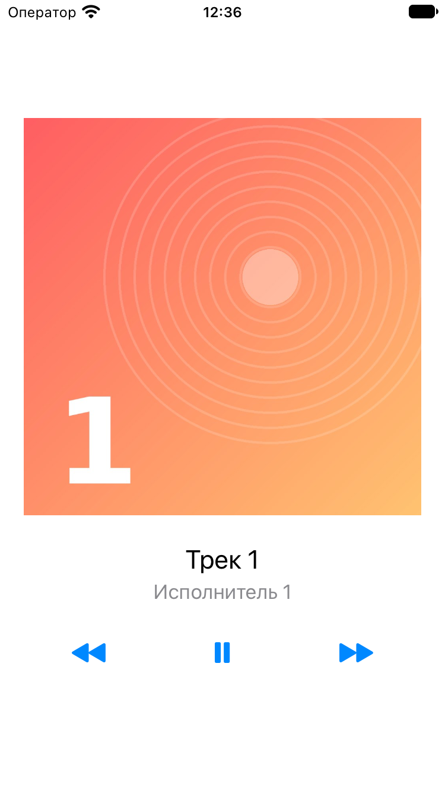
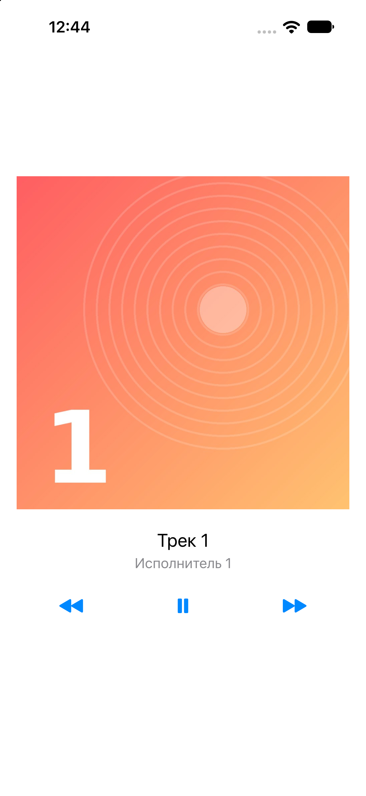

# Music Player — UIStackView & Auto Layout

A single-screen music player built with UIKit and Interface Builder.
It plays 10 audio files bundled with the app.

## Features
- Track cover (always square, 1:1), title and artist
- Previous / Play-Pause / Next buttons (SF Symbols: `backward.fill`, `play.fill` / `pause.fill`, `forward.fill`)
- Playback with `AVAudioPlayer`, files loaded via `Bundle.main.url(forResource:withExtension:)`
- Next / Previous keep the play state (if music was playing, the new track starts playing)
- Wrap-around: Next on the last track goes to the first, Previous on the first goes to the last
- When a track finishes, the next one starts automatically (`AVAudioPlayerDelegate`)
- A missing or broken file does not crash the app (message in the console + alert)

## Layout
- All layout is done in `Main.storyboard`, no layout code in Swift
- 3 stack views: vertical root stack → cover, vertical stack with two labels, horizontal stack with controls
- Root stack: 20 pt leading/trailing to the Safe Area, vertically centered
- Cover: aspect ratio 1:1
- No Auto Layout warnings or errors

## Project structure
| File | Purpose |
|---|---|
| `Track.swift` | `Track` model: `title`, `artist`, `fileName`, `coverImageName` |
| `TrackLibrary.swift` | The list of all tracks, defined in one place |
| `ViewController.swift` | Screen state (current track, play state), playback, UI updates |
| `track1.mp3` … `track10.mp3` | Audio files (Target Membership: MusicPlayer) |
| `Assets` → `cover1` … `cover10` | Cover images |

## Screenshots
| iPhone SE (3rd generation) | iPhone 16 Pro Max |
|---|---|
|  |  |

## Demo
Screen recording (play, pause, next, previous, wrap-around): [Screenshots/demo.mp4](Screenshots/demo.mp4)

## How to run
Open `MusicPlayer.xcodeproj` in Xcode and press Run (⌘R). No extra setup is needed.

## Credits
- Music: royalty-free tracks from [Pixabay Music](https://pixabay.com/music/)
- Cover images: generated for this project
